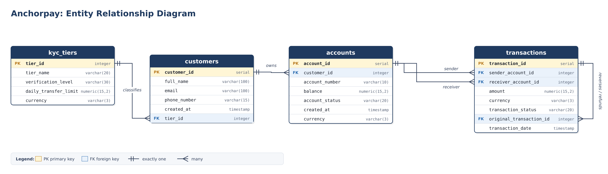
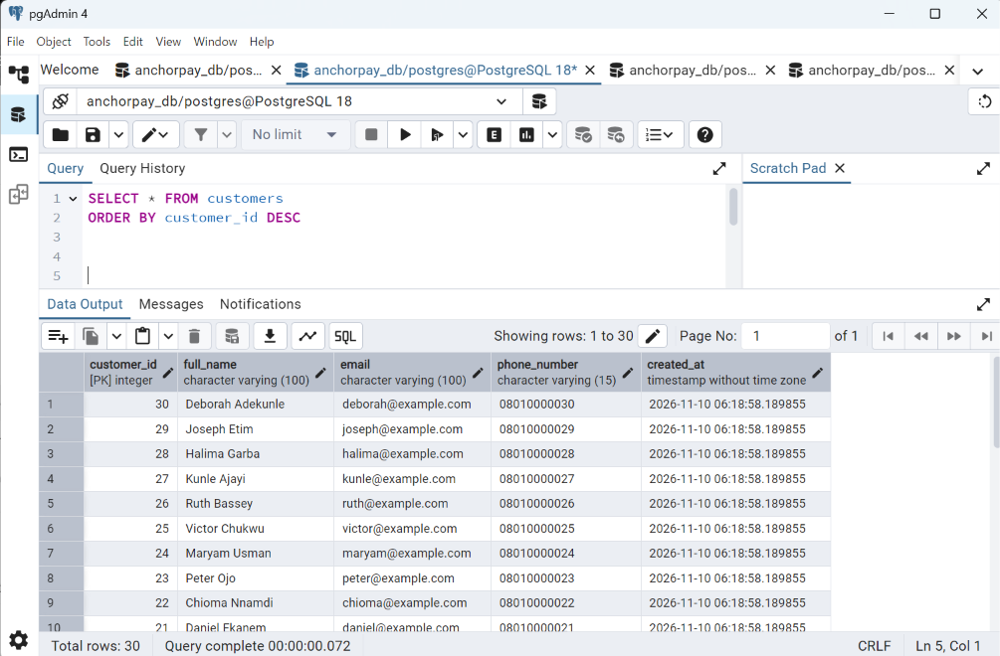
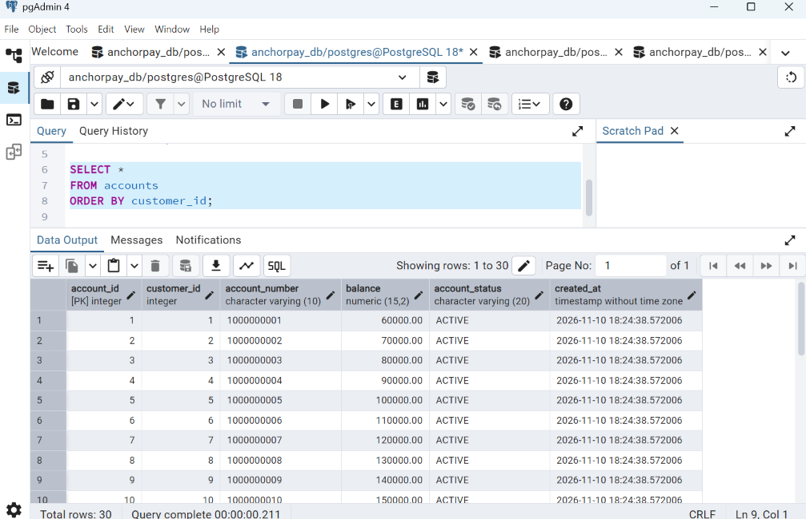
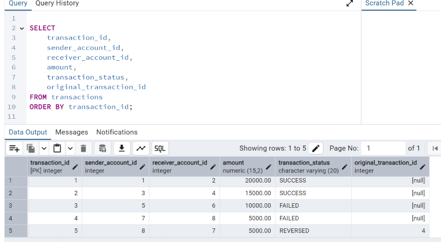
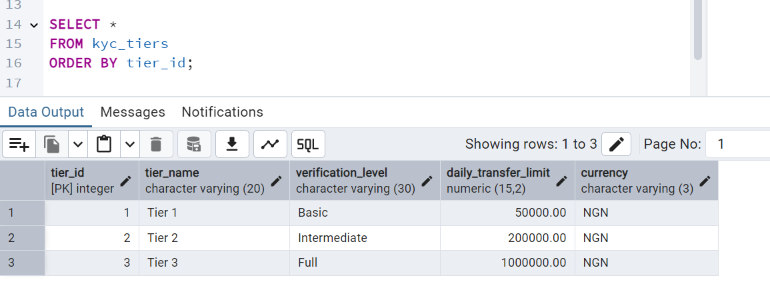

# Portfolio 1: Database Design and Modelling

## 1. Chosen Case Study: AnchorPay

For this portfolio, I chose **AnchorPay**, a fictional Nigerian fintech application where customers can register, have wallet accounts and transfer money to other accounts.

I designed a PostgreSQL database to keep track of customers, their KYC (Know Your Customer) levels, their accounts and their transfers. I used **pgAdmin 4** to create the database and view the ER diagram, and **VS Code** to organise my SQL files and documentation.

The database has four tables:

| Table | What it stores |
|---|---|
| `kyc_tiers` | KYC levels and their daily transfer limits |
| `customers` | Customer names, contact details and KYC levels |
| `accounts` | Wallet account numbers, balances, status and currency |
| `transactions` | Transfers, transaction status and links to reversal records |

### Basic rules for AnchorPay

- Each customer belongs to one KYC tier, but many customers can share the same tier.
- One customer can have more than one account. Each account belongs to one customer.
- Every transfer has a sending account and a receiving account.
- A reversal record can be linked to an earlier transaction. The database allows an original transaction to be referenced by **at most one** reversal record.
- Each KYC tier has a daily transfer limit. The database stores these limits, but checking them during transfers will be implemented later.

The sample KYC limits used in this project are **fictional** and are not official Central Bank of Nigeria limits.

## 2. Entity Relationship Diagram (ERD)

I created the ER diagram in pgAdmin to show the four tables and how they are connected.

*Figure 1: Entity Relationship Diagram of the AnchorPay database.*

The lines between the tables show their relationships:

| Relationship | What it means |
|---|---|
| `kyc_tiers` → `customers` | One KYC tier can be assigned to many customers. |
| `customers` → `accounts` | One customer can own many accounts. |
| `accounts` → `transactions` (sender) | One account can send many transfers. |
| `accounts` → `transactions` (receiver) | One account can receive many transfers. |
| `transactions` → `transactions` | A reversal record can refer to an earlier transaction. Each original can be referenced at most once. |

## 3. Relational Schema

The relational schema lists the tables and their columns. A **primary key (PK)** identifies a record, while a **foreign key (FK)** connects it to another table.

### 3.1 Tables and keys

| Table | Primary key | Foreign key(s) | What one row represents |
|---|---|---|---|
| `kyc_tiers` | **tier_id** | None | One KYC tier |
| `customers` | **customer_id** | `tier_id` | One registered customer |
| `accounts` | **account_id** | `customer_id` | One wallet account |
| `transactions` | **transaction_id** | `sender_account_id`, `receiver_account_id`, `original_transaction_id` | One transaction record |

### 3.2 Columns in each table

**`kyc_tiers`**

- **tier_id (PK)**
- tier_name
- verification_level
- daily_transfer_limit
- currency

**`customers`**

- **customer_id (PK)**
- full_name
- email
- phone_number
- created_at
- tier_id (FK → `kyc_tiers.tier_id`)

**`accounts`**

- **account_id (PK)**
- customer_id (FK → `customers.customer_id`)
- account_number
- balance
- account_status
- currency
- created_at

**`transactions`**

- **transaction_id (PK)**
- sender_account_id (FK → `accounts.account_id`)
- receiver_account_id (FK → `accounts.account_id`)
- amount
- currency
- transaction_status
- original_transaction_id (FK → `transactions.transaction_id`)
- transaction_date

I used `NUMERIC(15,2)` for money values such as balances and transfer amounts, so they can be stored with two decimal places without floating-point rounding errors.

## 4. Keys and Constraints

Keys help identify records and connect tables. Constraints are rules that stop some incorrect data from being saved.

| Rule | Example in AnchorPay | Why I used it |
|---|---|---|
| **PRIMARY KEY** | `customers.customer_id` | Gives each customer a unique ID. |
| **FOREIGN KEY** | `accounts.customer_id` | Makes sure an account points to an existing customer. |
| **UNIQUE** | `accounts.account_number` | Stops two accounts from having the same account number. |
| **NOT NULL** | `customers.full_name` | Makes sure a customer name is provided. |
| **CHECK** | `transactions.amount > 0` | Stops zero or negative transfer amounts. |
| **CHECK** | `accounts.balance >= 0` | Stops a negative balance from being stored. |
| **CHECK** | `kyc_tiers.daily_transfer_limit > 0` | Requires a positive daily transfer limit. |
| **CHECK** | Sender account must differ from receiver account | Stops transfers from an account to itself. |
| **DEFAULT** | Account currency is `NGN` | Fills in the usual value when none is provided. |

Other columns with **UNIQUE** rules are `kyc_tiers.tier_name`, `customers.email`, `customers.phone_number` and `transactions.original_transaction_id` (when a value is provided). The last rule helps prevent more than one reversal record from pointing to the same original transaction.

The database also sets default values such as `ACTIVE` for a new account status, `PENDING` for a new transaction status and the current time for date fields.

## 5. Normalisation

Normalisation means organising data into separate, related tables instead of repeating the same information in many places.

For example, several customers may belong to Tier 1. Rather than writing the Tier 1 daily transfer limit in every customer's record, I stored the limit once in `kyc_tiers` and linked each customer to the tier using `tier_id`.

| Normal form | Simple explanation | How I used it in AnchorPay |
|---|---|---|
| **1NF** | Each field holds one value, and each record can be identified. | Each customer, account and transaction has its own record and ID. |
| **2NF** | Information depends on the whole primary key. | All four tables have one-column primary keys, so there are no partial-key dependencies. |
| **3NF** | Information is kept in the table where it belongs, rather than being repeated unnecessarily. | KYC limits are kept in `kyc_tiers`, customer details in `customers`, account details in `accounts` and transfers in `transactions`. |

Based on the rules used for this project, I designed the four tables to follow **1NF, 2NF and 3NF**.

For a fuller explanation with examples, see [Database Normalisation](03_normalisation.md).

## 6. What Has Been Built and What Comes Next

For Portfolio 1, I created the four tables, added sample records, set up keys and constraints, and generated the ER diagram.

The `transactions` table currently records transfers and reversal links. It does **not** yet carry out the full process of safely deducting money from one account and adding it to another. I will work on that in **Portfolio 3**, along with checking daily transfer limits.

## 7. Project Files

| File | Purpose |
|---|---|
| [`01_create_tables.sql`](01_create_tables.sql) | SQL used to create the tables and define their structure |
| [`02_sample_data.sql`](02_sample_data.sql) | Sample data for testing the database |
| [`03_normalisation.md`](03_normalisation.md) | A more detailed explanation of normalisation |
| [`screenshots/anchorpay_erd.png`](screenshots/anchorpay_erd.png) | ER diagram showing the table relationships |

## 8. Conclusion

This portfolio helped me understand how to design a small relational database. I learned how to separate information into tables, connect them with keys and use constraints to protect the data. The AnchorPay database will be the starting point for the next portfolios, where I will work on queries, transactions and other database concepts.

## Database Implementation Screenshots

The screenshots below show the tables I created in PostgreSQL using pgAdmin.

### Customers Table

### Accounts Table

### Transactions Table

### KYC Tiers Table

