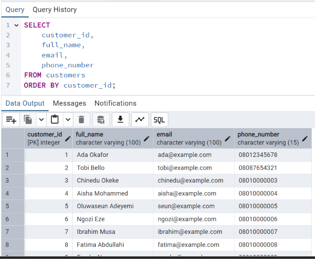
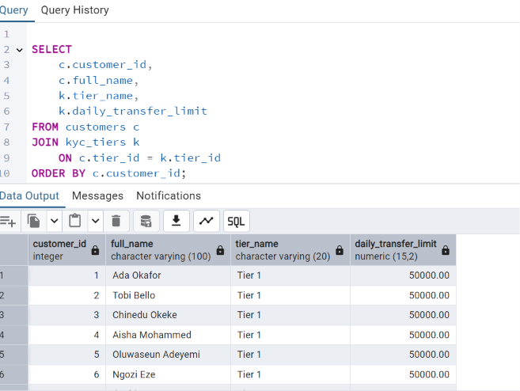
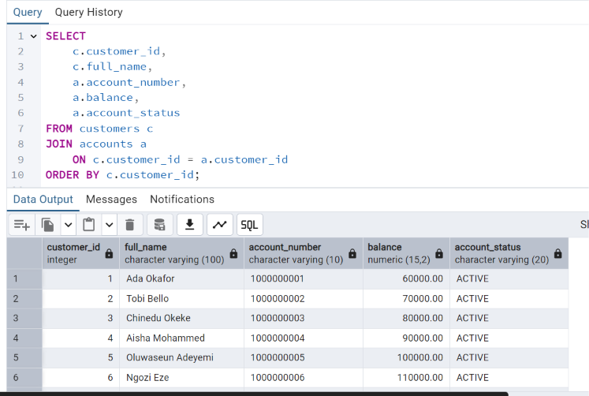
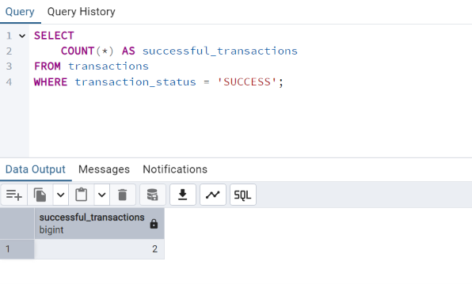
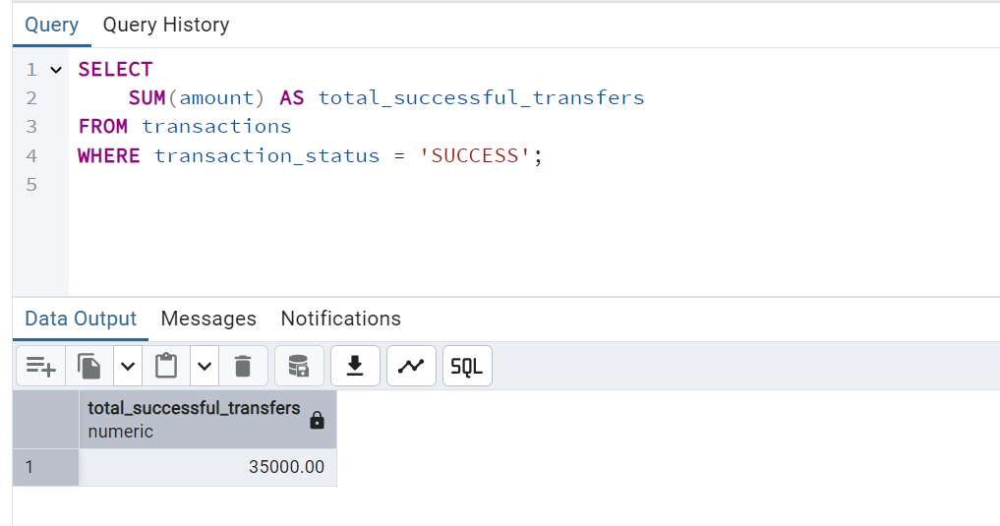
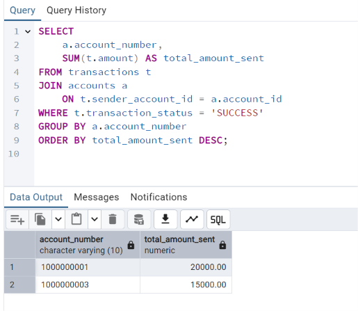
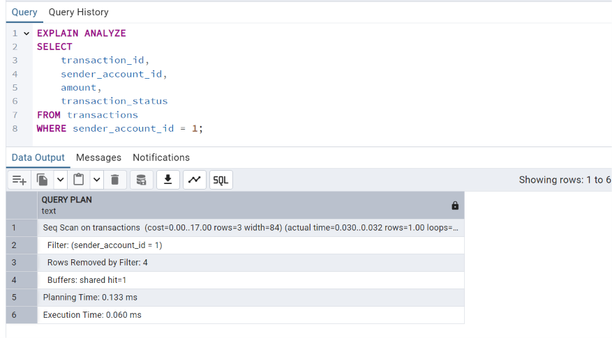
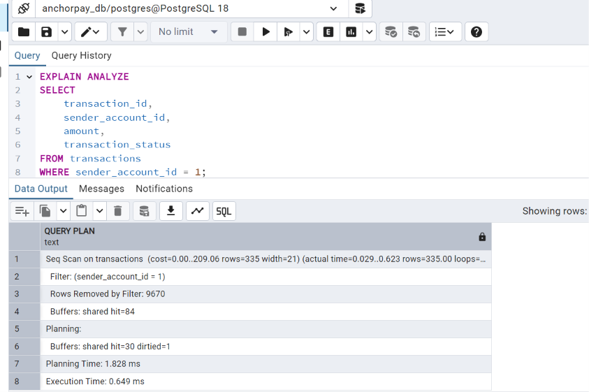
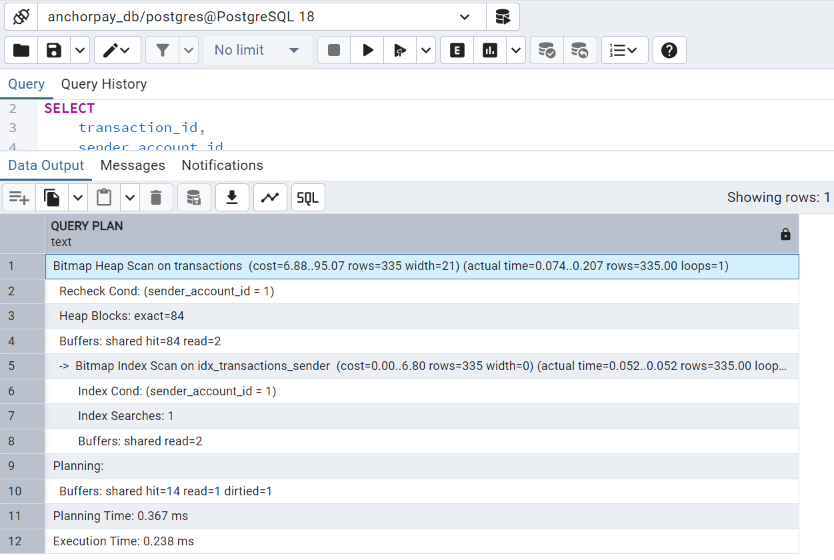

# Portfolio 2: Query Processing and Optimisation

## 1. Introduction

In Portfolio 1, I created the database tables and added sample data. For Portfolio 2, I wrote SQL queries to retrieve information and tested whether an index could make a transaction search faster.

**Tools used:** PostgreSQL 18, pgAdmin 4 and Visual Studio Code.

## 2. SQL Queries

I wrote six queries using the `customers`, `kyc_tiers`, `accounts` and `transactions` tables.

| Query | What I wanted to find out | SQL used |
|---|---|---|
| 1 | View registered customers | `SELECT`, `ORDER BY` |
| 2 | Show each customer's KYC tier and daily transfer limit | `JOIN` |
| 3 | Show customers with their account numbers and balances | `JOIN` |
| 4 | Count successful transfers | `COUNT`, `WHERE` |
| 5 | Calculate the total amount of successful transfers | `SUM`, `WHERE` |
| 6 | Find how much each sending account transferred successfully | `JOIN`, `SUM`, `GROUP BY`, `ORDER BY` |

The original sample data returned **2 successful transfers**, with a combined value of **₦35,000**. In Query 6, account `1000000001` had sent **₦20,000** and account `1000000003` had sent **₦15,000**.

The SQL statements are saved in [01_sql_queries.sql](01_sql_queries.sql).

### Query result screenshots













## 3. Checking Query Execution Plans

I used `EXPLAIN ANALYZE` to see how PostgreSQL searched the `transactions` table. I tested this query:

```sql
EXPLAIN ANALYZE
SELECT
    transaction_id,
    sender_account_id,
    amount,
    transaction_status
FROM transactions
WHERE sender_account_id = 1;
```

At first, the database contained **5 transactions**. PostgreSQL used a **Sequential Scan**, and the execution time was **0.060 ms**.

I then generated **10,000 additional fictional transactions** for testing, bringing the total to **10,005**. These records were added for query performance testing only; they did not update account balances.

After adding the records, I ran `ANALYZE transactions;` to update PostgreSQL's statistics.

With the larger dataset and **before creating the index**, PostgreSQL still used a **Sequential Scan**. The query found **335 matching transactions** and took **0.649 ms**.





The SQL used to inspect execution plans is saved in [02_execution_plans.sql](02_execution_plans.sql). The extra test data was generated using [04_generate_test_transactions.sql](04_generate_test_transactions.sql).

## 4. Creating an Index

I created an index on `sender_account_id` because the query searches for transactions sent by a particular account.

```sql
CREATE INDEX IF NOT EXISTS idx_transactions_sender
ON transactions(sender_account_id);
```

An index gives PostgreSQL another way to locate matching records instead of searching the entire table. It does not guarantee that every query will use the index.

I ran the **same `EXPLAIN ANALYZE` query** after creating the index. This time, PostgreSQL used a **Bitmap Index Scan** and **Bitmap Heap Scan**. The execution time was **0.238 ms**.



The index statement and after-index test are saved in [03_index_optimisation.sql](03_index_optimisation.sql).

## 5. Performance Comparison

I compared the same query on the same **10,005-record dataset**, before and after creating the index.

| Measurement | Before index | After index |
|---|---|---|
| Number of transactions in table | 10,005 | 10,005 |
| Matching transactions | 335 | 335 |
| Query method | Sequential Scan | Bitmap Index Scan + Bitmap Heap Scan |
| Execution time | 0.649 ms | 0.238 ms |

The execution time reduced by about **63.3%** in these two runs.

This showed me that the index helped PostgreSQL find the matching transactions faster in this test. However, these are results from individual runs, and execution times can vary. More repeated tests would be needed to confirm how consistent the improvement is.

## 6. What I Learned

Through this exercise, I learned how to:

- Retrieve and combine information from related tables using SQL.
- Count records and calculate totals using `COUNT()` and `SUM()`.
- Group transactions by account using `GROUP BY`.
- Read basic PostgreSQL execution plans using `EXPLAIN ANALYZE`.
- Create an index and compare query performance before and after indexing.

I also learned that adding an index does not automatically make every query faster. PostgreSQL chooses how to run a query based on the available data and statistics.

## 7. Project Files

| File or folder | Contents |
|---|---|
| [01_sql_queries.sql](01_sql_queries.sql) | Six SQL queries |
| [02_execution_plans.sql](02_execution_plans.sql) | Execution plan queries |
| [03_index_optimisation.sql](03_index_optimisation.sql) | Index creation and after-index test |
| [04_generate_test_transactions.sql](04_generate_test_transactions.sql) | Script to add 10,000 fictional test transactions |
| `screenshots/` | Query results and performance evidence |

**Note:** The test-data script adds more records each time it is run. It should not be rerun unless more test transactions are needed.

## 8. Conclusion

In Portfolio 2, I used SQL to answer basic questions about AnchorPay customers, accounts and transfers. I also tested a transaction search before and after creating an index.

The index was used in the second execution plan, and the query ran faster in the recorded test. This helped me understand how indexing and execution plans can be used to check database performance.
