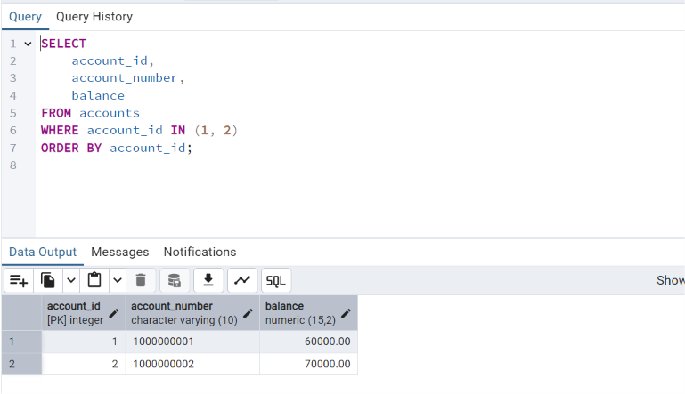
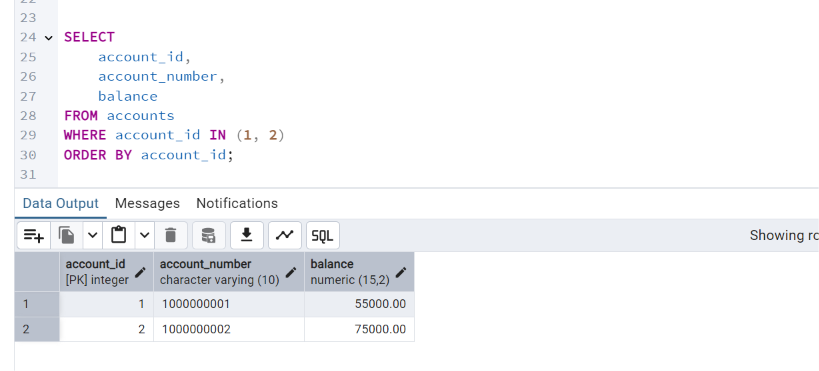
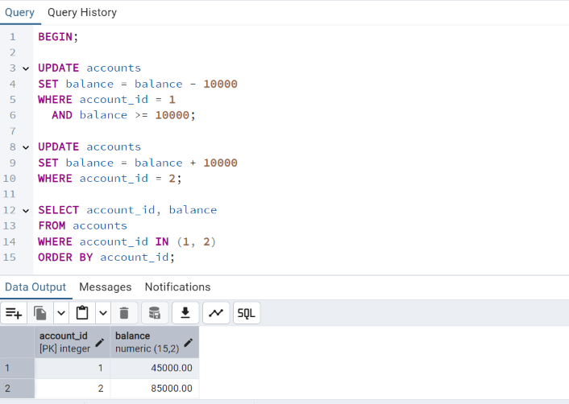
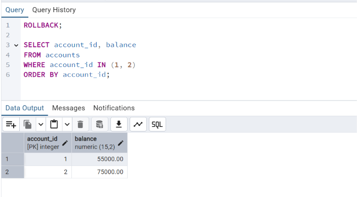
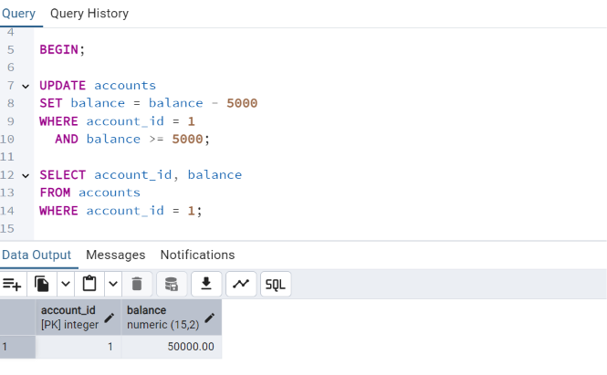
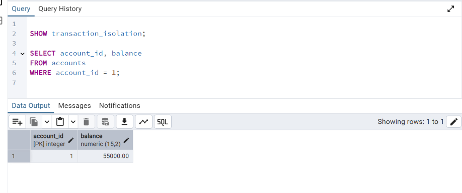
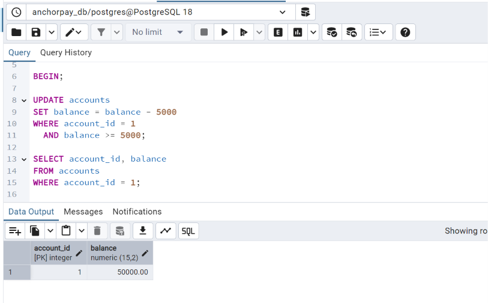
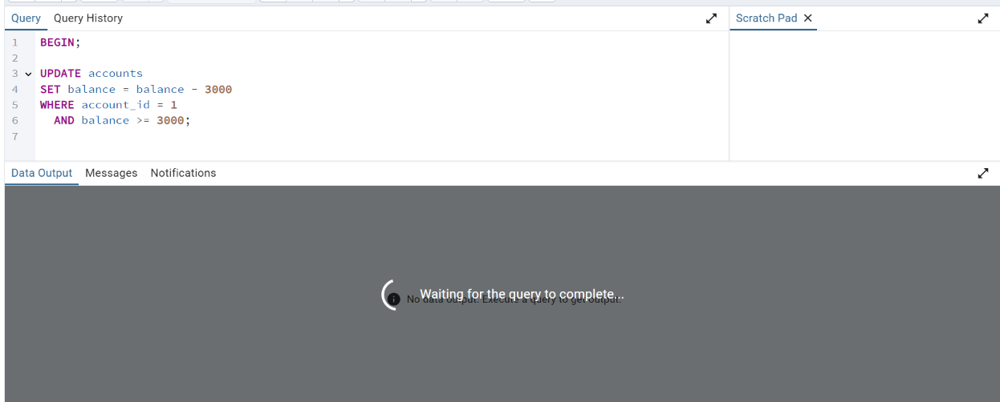
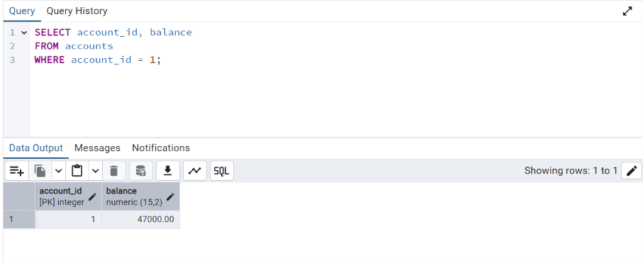

# Portfolio 3: Transactions and Concurrency

## 1. Introduction

This is the third part of my AnchorPay database project, a fictional Nigerian fintech platform.

In this portfolio, I used PostgreSQL to learn how database transactions work and what happens when two users try to update the same account at the same time.

I tested COMMIT, ROLLBACK, isolation and concurrency.

## 2. Tools Used

- PostgreSQL 18
- pgAdmin 4
- Visual Studio Code
- SQL

## 3. COMMIT — Saving a Transaction

I transferred ₦5,000 from Account 1 to Account 2.

After running COMMIT, both account balances were updated.

| Account | Before | After |
|---|---:|---:|
| Account 1 | ₦60,000 | ₦55,000 |
| Account 2 | ₦70,000 | ₦75,000 |

This showed that COMMIT saves changes made during a transaction.

**Screenshots:**

## 4. ROLLBACK — Cancelling a Transaction

I attempted another transfer of ₦10,000 but cancelled it using ROLLBACK.

| Account | Before ROLLBACK | After ROLLBACK |
|---|---:|---:|
| Account 1 | ₦45,000 | ₦55,000 |
| Account 2 | ₦85,000 | ₦75,000 |

This showed that ROLLBACK cancels changes that have not been saved.

**Screenshots:**

## 5. Transaction Isolation

I opened two pgAdmin sessions to check how PostgreSQL handles uncommitted changes.

In Session A, I deducted ₦5,000 from Account 1 without committing.

Session A showed ₦50,000, while Session B still showed ₦55,000.

This showed that Session B could not see the changes made in Session A until they were committed.

I used ROLLBACK to cancel the temporary deduction.

**Screenshots:**

## 6. Concurrency — Two Transactions at the Same Time

I used two pgAdmin sessions to update Account 1.

Session A deducted ₦5,000 from the starting balance of ₦55,000.

While Session A was still running, Session B tried to deduct another ₦3,000.

Session B had to wait until Session A committed before its UPDATE could finish.

| Stage | Balance |
|---|---:|
| Starting balance | ₦55,000 |
| Session A deducts ₦5,000 | ₦50,000 |
| Session B waits | No update yet |
| Session B's UPDATE completes | ₦47,000 |

This helped me understand how PostgreSQL uses row locking to prevent two transactions from updating the same record at the same time.

**Screenshots:**

## 7. ACID Properties

ACID describes four important rules for database transactions.

| Property | Simple Meaning |
|---|---|
| Atomicity | Related changes should succeed together or fail together |
| Consistency | Database rules should be maintained |
| Isolation | One transaction should not see another's uncommitted changes |
| Durability | Committed changes should remain saved |

## 8. SQL Files

- [01_commit.sql](01_commit.sql)
- [02_rollback.sql](02_rollback.sql)
- [03_isolation.sql](03_isolation.sql)
- [04_concurrency.sql](04_concurrency.sql)

## 9. What I Learned

I learned how COMMIT saves changes and how ROLLBACK cancels them.

I also learned that PostgreSQL prevents one session from seeing another session's uncommitted changes.

The concurrency exercise showed me why row locking is important when two transactions try to update the same account.

These exercises helped me understand how databases protect financial records during transactions.
