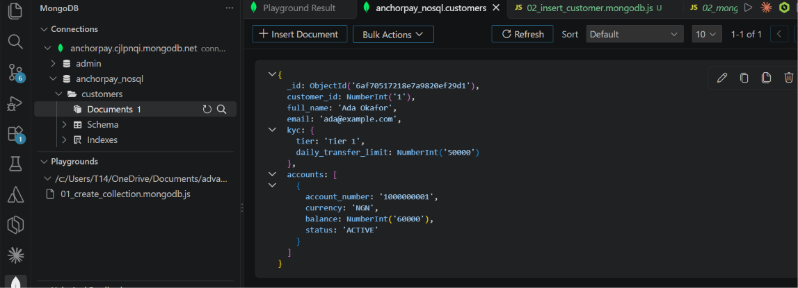
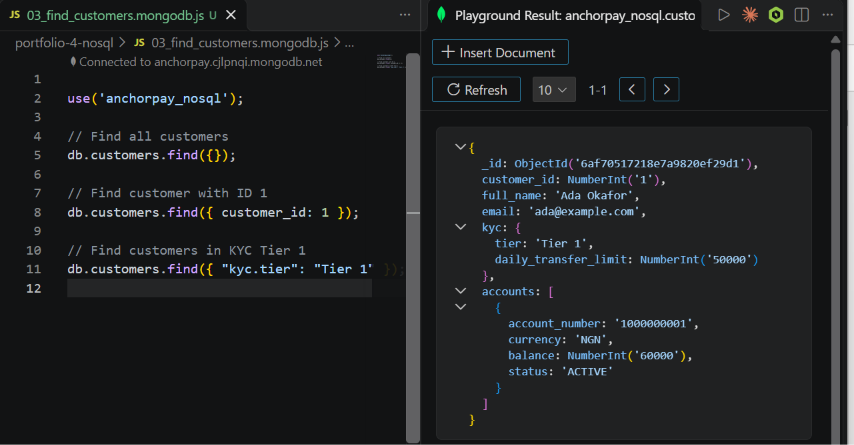
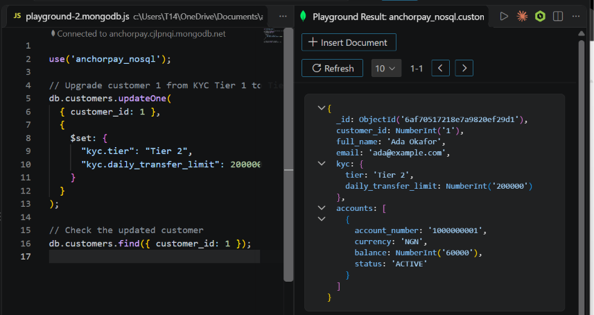
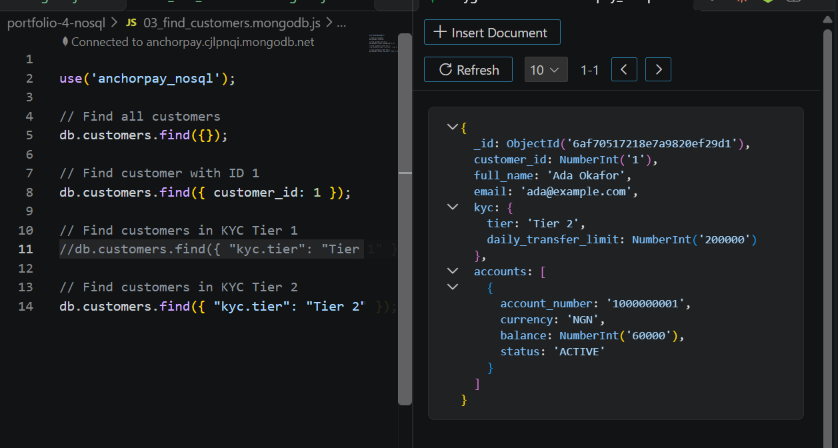

# Portfolio 4: NoSQL and Advanced Data Models

## 1. Introduction

This portfolio explores the use of NoSQL databases in AnchorPay, a fictional Nigerian fintech platform.

In Portfolio 1, I used PostgreSQL to store customer, account, KYC and transaction information in related tables.

In this portfolio, I used MongoDB to explore a different way of storing information. Instead of separating related customer details into different tables, MongoDB allows them to be stored together in a document.

## 2. Tools Used

- MongoDB Atlas — to host the database online.
- MongoDB for VS Code — to connect to the database and run queries.
- Visual Studio Code — to write and save MongoDB Playground files.

## 3. Understanding NoSQL Data Models

NoSQL databases can organise information in different ways.

- **Document model:** Stores related information together in a document, similar to keeping a customer's details in one folder.
- **Key-value model:** Stores information using a unique key, similar to saving a phone number under a person's name.
- **Wide-column model:** Organises large amounts of data using columns and partitions.
- **Graph model:** Focuses on relationships between records, similar to a family tree.

For this portfolio, I selected the **document model using MongoDB**.

The other models were reviewed conceptually but were not implemented.

## 4. MongoDB Document Model

I created a database named `anchorpay_nosql` and a collection named `customers`.

The customer document contains personal information, KYC details and account information.

Example:

```json
{
  "customer_id": 1,
  "full_name": "Ada Okafor",
  "email": "ada@example.com",
  "kyc": {
    "tier": "Tier 2",
    "daily_transfer_limit": 200000
  },
  "accounts": [
    {
      "account_number": "1000000001",
      "currency": "NGN",
      "balance": 60000,
      "status": "ACTIVE"
    }
  ]
}
```

All customer information used in this exercise is fictional.

## 5. Implementation

### Step 1: Create a Collection

I created a MongoDB collection named `customers` inside the `anchorpay_nosql` database.

**File:** `01_create_collection.mongodb.js`

### Step 2: Insert Customer Information

I inserted a customer document containing the customer's name, email, KYC details and account information.

**File:** `02_insert_customer.mongodb.js`



### Step 3: Retrieve Customer Information

I used the `find()` method to retrieve customer information.

I tested queries to:
- Find all customers.
- Find a customer using their customer ID.
- Find customers belonging to a particular KYC tier.

**File:** `03_find_customers.mongodb.js`



### Step 4: Update Customer Information

I used `updateOne()` to change Ada Okafor's KYC tier from Tier 1 to Tier 2.

The daily transfer limit was also changed from NGN 50,000 to NGN 200,000.

**File:** `04_update_customer.mongodb.js`



### Step 5: Verify the Update

I ran another query to find customers in KYC Tier 2.

The result returned Ada Okafor with the updated KYC tier and daily transfer limit.

This confirmed that the update was saved successfully.



## 6. Why MongoDB Is Suitable for AnchorPay

MongoDB can be useful for storing customer profile information because related details can be kept together in one document.

For example, a customer's personal information, KYC details and accounts can be retrieved without joining multiple tables.

MongoDB also allows documents to have different fields, which can be helpful when customer profiles contain different types of information.

However, PostgreSQL remains suitable for AnchorPay's financial transaction records because it supports relational constraints and reliable transaction processing.

In this exercise, MongoDB was used only to demonstrate customer profile storage. The account balance is sample data and is not connected to the PostgreSQL database.

## 7. What I Learned

Through this exercise, I learned how to:

- Create a database and collection in MongoDB.
- Insert customer information into a document.
- Retrieve documents using `find()`.
- Update information using `updateOne()`.
- Store related information using nested documents and arrays.
- Understand the basic differences between NoSQL data models.
- Identify situations where MongoDB may be useful.

## 8. Conclusion

This portfolio demonstrated how MongoDB can be used to store and manage customer information for AnchorPay.

I successfully created a collection, inserted a customer document, retrieved information, updated KYC details and verified the changes.

The exercise helped me understand how a document database differs from the relational database used in Portfolio 1.
