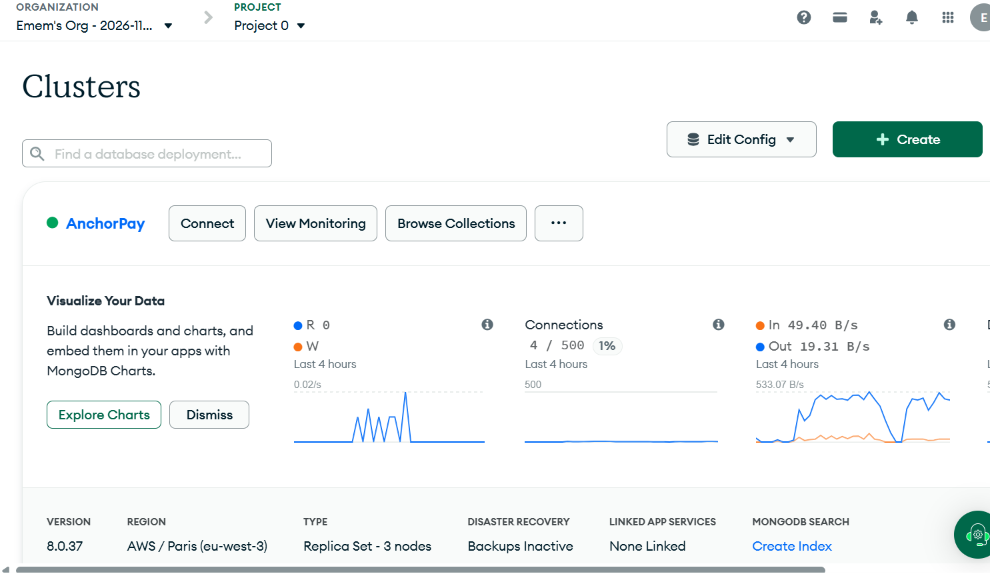
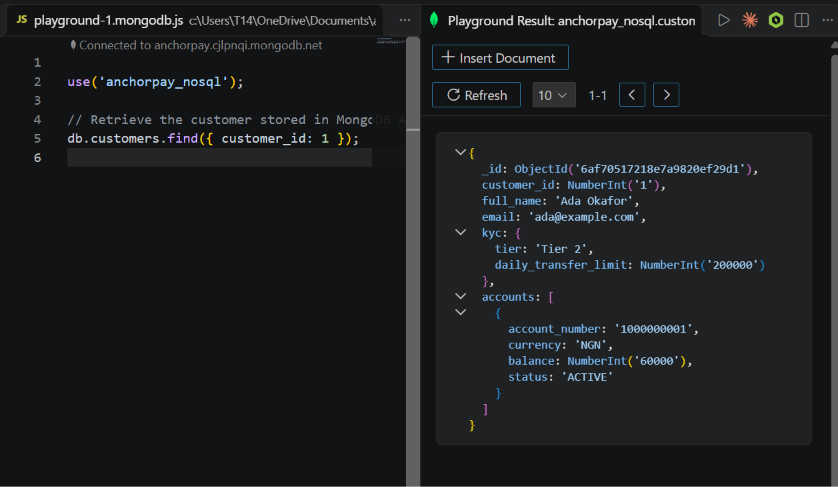
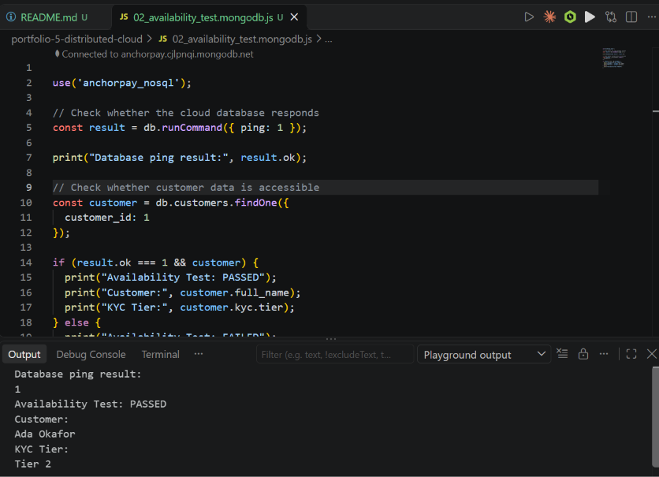

# Portfolio 5: Distributed and Cloud Database Exercise

## 1. Introduction

This portfolio explores how cloud and distributed databases can support AnchorPay, a fictional Nigerian fintech platform.

A cloud database is a database hosted online instead of on a personal computer. A distributed database uses multiple computers or servers to manage data.

For this exercise, I used MongoDB Atlas, the cloud database I created in Portfolio 4, to demonstrate cloud database deployment, replication and availability.

I also explored the concepts of sharding, consistency and failover.

## 2. Tools Used

- MongoDB Atlas — to host the database online.
- MongoDB for VS Code — to connect to the database and run queries.
- Visual Studio Code — to write and execute MongoDB Playground scripts.

## 3. Cloud Database Deployment

I used an existing MongoDB Atlas cluster named `AnchorPay`.

The cluster has the following configuration:

| Feature | Configuration |
|---|---|
| Cloud provider | Amazon Web Services (AWS) |
| Region | Paris (eu-west-3) |
| MongoDB version | 8.0.37 |
| Deployment type | Replica Set — 3 nodes |
| Database name | anchorpay_nosql |

The cluster is hosted in the cloud, so I can connect to it through VS Code without installing a MongoDB database server on my computer.

The screenshot below shows the AnchorPay cluster in MongoDB Atlas.



## 4. Replication

Replication means keeping copies of the same database information on multiple servers.

My MongoDB Atlas cluster uses a three-node replica set.

In a typical replica set:
- One node acts as the primary and handles database writes.
- The other nodes act as secondary nodes and replicate data from the primary.

For AnchorPay, replication can help protect customer information from becoming unavailable when one database server fails.

The Atlas deployment screenshot confirms that the cluster uses a three-node replica set.

I did not manually configure replication or test individual replica-set nodes.

## 5. Cloud Database Query

I connected to the MongoDB Atlas cluster using the MongoDB extension in VS Code.

I ran the following query to retrieve a customer:

```javascript
use('anchorpay_nosql');

db.customers.find({ customer_id: 1 });
```

The query returned Ada Okafor's customer information, including her updated KYC Tier 2 and daily transfer limit of NGN 200,000.

This confirmed that I could connect to the cloud database and retrieve stored information.



## 6. Availability Testing

Availability means that a database is accessible when users or applications need it.

For example, when a customer opens AnchorPay, the application should be able to retrieve their account information.

I tested database availability using MongoDB's `ping` command and a customer lookup.

**File:** `01_availability_test.mongodb.js`

The test checked whether:
1. The database responded to a ping.
2. The customer document could be retrieved.

### Test Results

| Test | Result |
|---|---|
| Database ping | 1 |
| Customer lookup | Ada Okafor |
| KYC Tier | Tier 2 |
| Availability test | PASSED |

The test passed, confirming that the database was reachable and customer information was accessible at the time of testing.



This was a basic availability test. It did not measure continuous uptime or simulate a server failure.

## 7. Failover

Failover means switching to another available server when the server currently handling requests fails.

For example, if AnchorPay's primary database server becomes unavailable, an eligible secondary node in the replica set can be elected as the new primary.

This helps the database recover from certain server failures.

My MongoDB Atlas cluster has a three-node replica set, but I did not deliberately trigger a failover.

Failover was discussed as a concept rather than tested.

## 8. Sharding

Sharding means dividing a large database into smaller parts called shards and distributing them across different servers.

For example, if AnchorPay processes millions of transactions every day, sharding could help distribute transaction records across multiple servers.

This can help a database handle growing amounts of information and requests.

Sharding was not implemented because my existing MongoDB Atlas deployment uses a replica set rather than a sharded cluster.

It could be considered in the future if AnchorPay's data volume and workload increase significantly.

## 9. Data Consistency

Data consistency means ensuring that database information follows the required rules and that users receive appropriately up-to-date information.

This is important for a fintech platform because incorrect customer or transaction information can cause problems.

For example, when a customer's KYC tier changes, the new information should be saved correctly.

In Portfolio 4, I updated Ada Okafor's KYC tier from Tier 1 to Tier 2.

In this portfolio, I retrieved her customer document again and confirmed that the updated KYC tier was still stored in MongoDB Atlas.

This verified that the update was saved and could be retrieved successfully.

## 10. Why Cloud and Distributed Databases Are Useful for AnchorPay

Cloud databases allow AnchorPay to store and access information without maintaining its own physical database servers.

Replication can improve availability by keeping copies of data on multiple nodes.

Failover can help the database recover when a primary node becomes unavailable.

Sharding could support future growth by distributing large amounts of data across servers.

Consistency is especially important because AnchorPay handles financial and customer information that must remain accurate.

## 11. What I Learned

Through this exercise, I learned how to:

- Identify a cloud-hosted database deployment.
- Connect to MongoDB Atlas from VS Code.
- Retrieve customer information from a cloud database.
- Check database availability using the ping command.
- Understand how a three-node replica set works.
- Explain replication, failover, sharding and consistency.
- Identify how these concepts can support a fintech platform.

## 12. Conclusion

This portfolio demonstrated the use of a cloud-hosted MongoDB database for AnchorPay.

I confirmed the MongoDB Atlas deployment, identified its three-node replica-set configuration, retrieved customer information and successfully completed a basic availability test.

I also explained how replication, failover, sharding and data consistency relate to the needs of a fintech platform.

The exercise helped me understand how cloud and distributed database concepts can support reliable database systems.
